<p align="center">
  <a href="https://kotviccodes.github.io/Cheap-Drive/video/">
    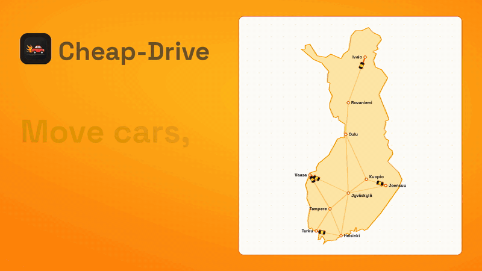
  </a>
</p>

<h1 align="center">
   Cheap-Drive
</h1>

<p align="center">
  <b>Win the right work. Deliver it.</b><br>
  A Python dispatcher for the Spread challenge at Junction 2026, using the official client.<br>
  Team <b>Guardians of the Moonlight</b>.
</p>

<p align="center">
  <a href="https://kotviccodes.github.io/Cheap-Drive/video/"><b>Watch the film</b></a> (72 s) &nbsp;|&nbsp;
  <a href="presentations/cheap-drive-alpha-to-gamma.html"><b>Slides</b></a> (<a href="presentations/Cheap-Drive-from-Alpha-to-Epsilon.pdf">PDF</a>) &nbsp;|&nbsp;
  <a href="https://kotviccodes.github.io/Cheap-Drive/"><b>Try the live report</b></a> &nbsp;|&nbsp;
  <a href="https://spread.bahnexpress.com/leaderboard">Leaderboard</a>
</p>

<p align="center">
  <a href="https://github.com/KotvicCodes/Cheap-Drive/actions/workflows/checks.yml"></a>
  
  
  
</p>

## Standings

**We finished the real final 29th of 58 ranked teams: €16,760.47 gross margin,
97.61% on time, 376 orders won.** Epsilon Prime played it live on Sunday
15 November 2026, 09:00–09:34 Helsinki (the final moved from 08:00). Leader
**Juhus** made €22,930.87; tenth-place **Evil Club** €19,083.95.

| Event (Helsinki) | Model | Rank | Gross margin | On time | Orders won |
| --- | --- | ---: | ---: | ---: | ---: |
| [Real final, Sun 09:00](docs/research/final-board.md) | Epsilon Prime | **29 / 58** | **€16,760.47** | **97.61%** | **376** |
| [Round 12, Sun 06:00](docs/research/epsilon-prime-board-round12.md) | Epsilon Prime | 34 / 51 | €69,640.20 | 97.25% | 1,779 |
| [Round 11, Sun 03:00](docs/research/epsilon-board-round11.md#closed-round-update) | Early Epsilon | 32 / 48 | €69,301.34 | 95.85% | 1,664 |
| [Round 10, Sun 00:00](docs/research/delta-board-round10.md) | Delta | 38 / 58 | €72,322.03 | 96.27% | 1,742 |
| [Round 9, Sat 21:00](docs/research/delta-board-round9.md) | Delta | 31 / 52 | €75,763.55 | 96.72% | 1,798 |
| [Round 8, Sat 18:00](docs/research/delta-board-round8.md) | Early Delta | 37 / 58 | €55,639.62 | 96.96% | 1,248 |
| [Round 7, Sat 15:00](docs/research/gamma-board-round7.md) | Gamma | 41 / 62 | €66,880.48 | 96.75% | 1,383 |

Rounds are five secret weeks each and the final is one; different events use
different weeks, so totals are not a paired model comparison. Every ranking
round we entered qualified on all five weeks. Rounds 8, 9 and 12 are open-round
or latest-at-retrieval snapshots; see each evidence page.

<p align="center">
  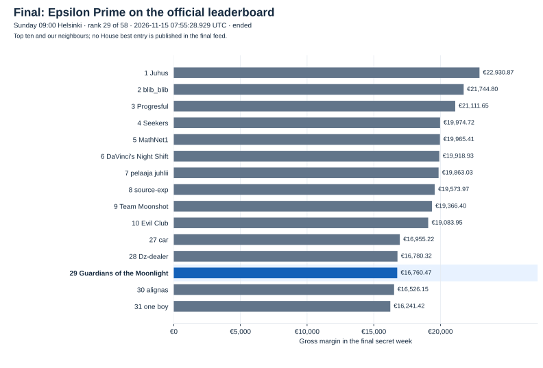
</p>

<table>
  <tr>
    <td width="50%">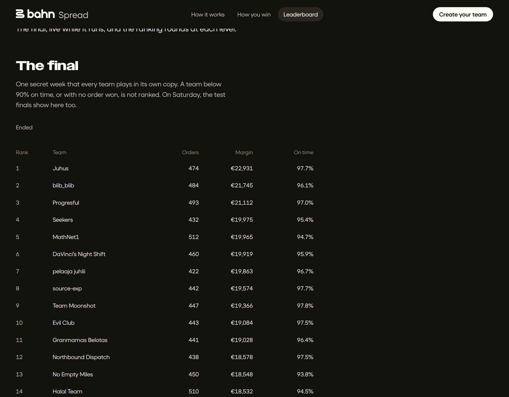</td>
    <td width="50%"></td>
  </tr>
  <tr>
    <td colspan="2"><sub>Real public-page screenshots and exact-cent feed figures, retrieved 15 November 2026 at 09:55 Helsinki.
    Model settings and scores match local traces; the runtime source commit is unverified.
    <a href="docs/research/final-board.md">Final evidence</a>.</sub></td>
  </tr>
</table>

<details>
<summary><b>Round 12, round 11 and the test finals</b>: charts and screenshots</summary>

**Round 12** ("Sunday 06:00"): all five Epsilon Prime weeks qualified, worst
94.00% on time. The feed gives no closed flag, so 34 of 51 is the latest
standing at retrieval. [Round-12 evidence](docs/research/epsilon-prime-board-round12.md).

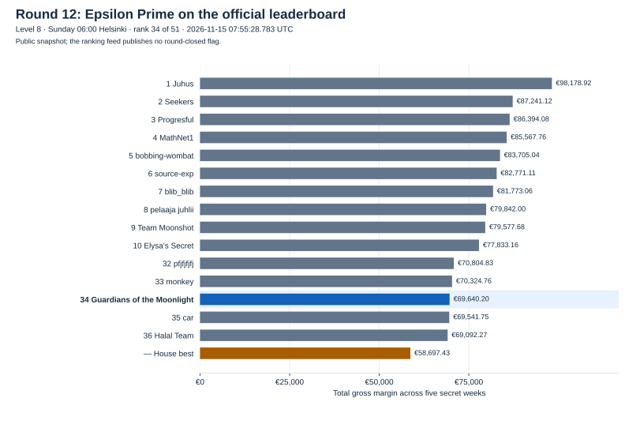
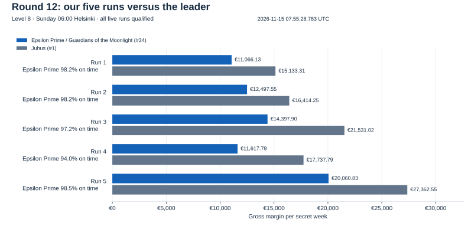
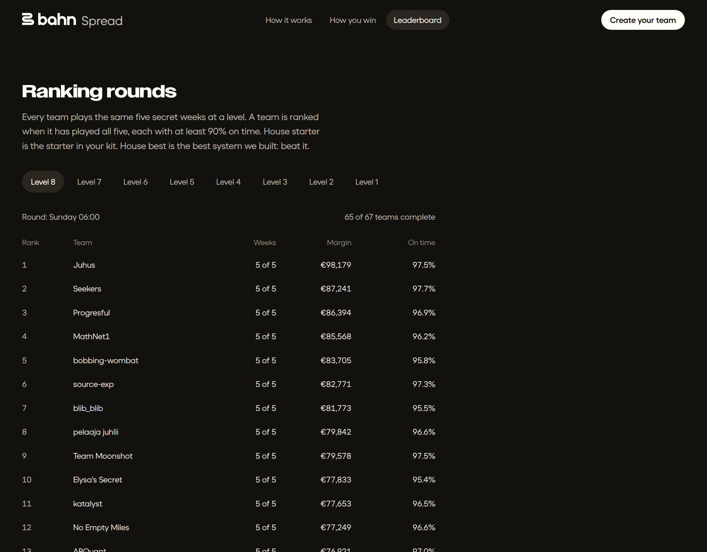


**Round 11** ("Sunday 03:00") closed at **32nd of 48** with Early Epsilon
([models/epsilon-early.json](models/epsilon-early.json): Delta plus
`premium_min_slack_minutes: 1440`). The charts below are the open-round capture
from 05:16 Helsinki, when we stood 28th of 44.

| Early Epsilon run | Gross margin | On time | Orders won | Ranked |
| --- | ---: | ---: | ---: | :---: |
| 1 | €13,985.11 | 96.45% | 310 | Yes |
| 2 | €12,122.31 | 97.12% | 313 | Yes |
| 3 | €9,229.95 | 93.63% | 314 | Yes |
| 4 | €19,254.35 | 95.77% | 378 | Yes |
| 5 | €14,709.62 | 96.28% | 349 | Yes |
| **Total** | **€69,301.34** | **95.85%** | **1,664** | **5 / 5** |

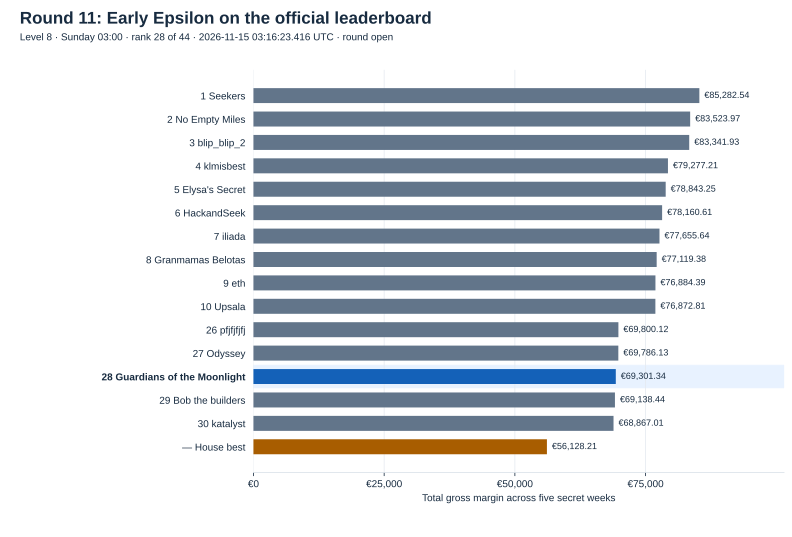
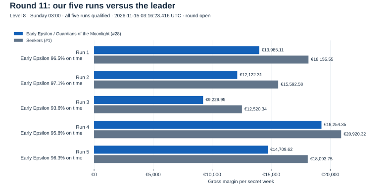

**Round 10** used `models/delta.json` (`premium_min_slack_minutes: 600`) at
[`cae1e58`](https://github.com/KotvicCodes/Cheap-Drive/commit/cae1e58b8ce3234260328f78dcf2283cd2ebced7),
confirmed by saved provenance and all five trace headers.

**Test final**, 14 November 2026, 20:00 Helsinki: Delta via `final.py` finished
**42nd of 75**, €12,816.67, 99.61% on time, 256 orders. A server restart dropped
the connection twice around simulated Friday and the runner rebuilt its desk on
Saturday; requests in that gap went unanswered.
[Test-final evidence](docs/research/delta-test-final-2.md).


**Unannounced live event**, night of 14–15 November: no dispatcher was waiting
when a scored final-mode world started seven hours early; Delta joined late and
finished 38th of 41 with €2,374.14.
[Post-mortem](docs/research/surprise-final-postmortem.md).

Older rounds and charts: [screenshots index](docs/screenshots/README.md).

</details>

## Five models, one loop

Every model was a hypothesis about a car-delivery market: quote a price for each
request, win the order, then hire drivers who deliver it on time. Each one was
tested on hundreds of simulated practice weeks before it touched a ranking round.

<p align="center">
  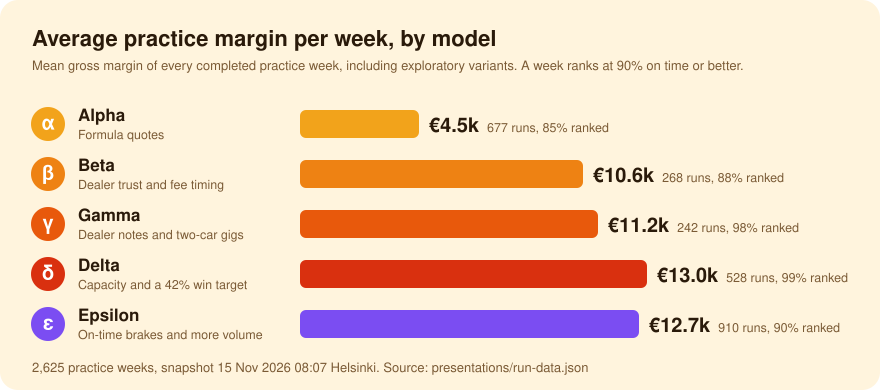
</p>

Epsilon's average sits just under Delta's because its 910 weeks include every
exploratory variant. The selected Epsilon Prime added €456/week over Early Epsilon
on 38 paired weeks, all ranked ([presentation notes](presentations/README.md)).
Chart source: [run data](presentations/run-data.json), rebuilt by
[make_model_ladder.py](docs/readme/make_model_ladder.py).

<p align="center">
  <a href="presentations/Cheap-Drive-from-Alpha-to-Epsilon.pdf">
    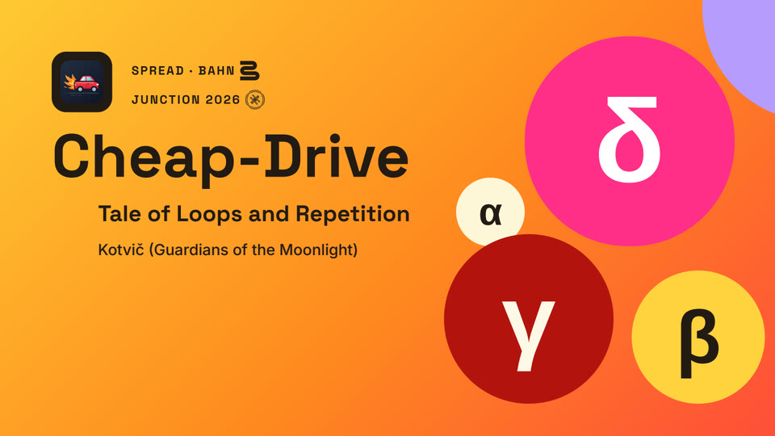
  </a><br>
  <sub>Ten slides from Alpha to Epsilon: <a href="presentations/cheap-drive-alpha-to-gamma.html">HTML</a> or <a href="presentations/Cheap-Drive-from-Alpha-to-Epsilon.pdf">PDF</a>. The film's sources and timeline are in <a href="docs/demo-video/README.md">docs/demo-video</a>.</sub>
</p>

### What drove the changes

- List price ≈ driver cost away from the shortest routes; price each option from its own list.
- The markup must find each week's market; a fixed markup won very different volumes across weeks.
- Drivers learned to wait for fee raises. Open lower and spread the rise over the order's own time.
- Long routes caused half the late orders; the 500 km limit made all eight weeks rank.

## See a week

`week_report.py` turns one saved trace into an offline HTML report: margin over
time, every order with its note, pickup window and outcome. The
[live report](https://kotviccodes.github.io/Cheap-Drive/) puts real practice weeks
from each model side by side.

<p align="center">
  <a href="https://kotviccodes.github.io/Cheap-Drive/">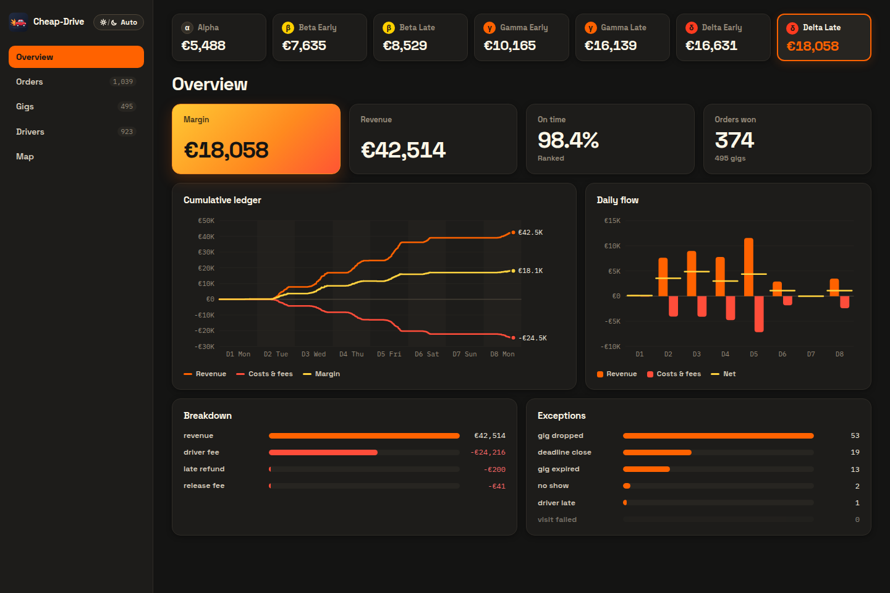</a><br>
  <sub>More views: <a href="docs/screenshots/README.md">orders, history and mobile screenshots</a>.</sub>
</p>

## The models

<details>
<summary><b>Epsilon and Delta</b>: the models we ran on Sunday</summary>

**Early Epsilon** ([models/epsilon-early.json](models/epsilon-early.json)) is Delta plus
`premium_min_slack_minutes: 1440`. Epsilon's tuning notes:
[epsilon-tuning](docs/research/epsilon-tuning.md), [Epsilon Prime](docs/research/epsilon-prime.md).

**Delta** ([models/delta.json](models/delta.json)) takes on more work and offers it to
drivers better: a 42% win target instead of 30%, stops posted for the whole span an order
allows, pairs searched over 90 km, and rescue for overdue private deliveries. Over 19
paired practice weeks it earned **€1,664/week more than Early Delta** (17 of 19 weeks
ahead; 8 of the weeks unseen: +€1,389, 7 of 8), winning 342 orders a week instead of 257,
every week ranked. On time is lower: 95.7% on average against 96.9%, worst week 91.1%
against 93.7%.

**Early Delta** ([models/delta-early.json](models/delta-early.json)) is Gamma plus two
repairs: bounded note corrections and a rescue-window fix. It beat Gamma on 11 of 11 unseen
weeks by €682/week (+€518/week over 27 paired weeks). The pricing experiments in between
(segments, lanes, small intake changes, learner, price spread) did not hold on fresh weeks.
[Delta results](docs/research/delta-results.md) · [next steps](docs/research/delta-next-steps.md) ·
[testing plan](docs/research/delta-testing-plan.md).

Model code lives in the [models package](models/), alongside its JSON configs.
Runners and tools stay at the root and in `scripts/`. Old imports and saved factory
names still work through one-line module aliases; see
[model compatibility](docs/reference.md#model-package-compatibility).

</details>

<details>
<summary><b>Gamma</b>: the first fully qualified baseline</summary>

Gamma passed a frozen eight-seed confirmation against Beta: **8/8 ranked and
8/8 more profitable**, gaining **€2,031/week (+20.21%)**, with **96.95% worst
on-time delivery**. See the [recovery results](docs/research/gamma-recovery-results.md)
for the selection process, exact comparisons and remaining limits.

[models/gamma.json](models/gamma.json) uses `models.gamma_notes:make_gamma_notes_pairs`:
correct note dates/readiness and recurring business hours, guarded 500–700 km
routes, short-route/premium-car fee controls, and two-car pairs. Fresh pairs
open at 0.72 × summed reference fees; waiting-car rescue pairs open at 0.78 ×
with a new 60-minute flat period. Pair idle wait at the second pickup is capped
at 60 minutes. The brake, roster scaling and town caps remain disabled.

Fresh confirmation on `gamma-v09` … `gamma-v16`, selected before any candidate
outcome on those seeds. On-time means are means of weekly shares.

| Model | Margin / week | Weeks ranked | On time: worst / mean | Orders / week |
| --- | ---: | ---: | ---: | ---: |
| Beta | €10,047.87 | 8 of 8 | 93.67% / 95.69% | 241.6 |
| Gamma | €12,078.71 | 8 of 8 | 96.95% / 98.06% | 256.3 |

Every paired week improved margin, by €886.79–€2,630.60. Only 1 of 148 won,
noncancelled long-route orders was late (0.68%, including undelivered orders).
Gamma also ranked on all eight screening weeks and three known difficult weeks;
those are exposed diagnostics, separate from confirmation.

Beta remains available in [models/beta.json](models/beta.json). The original
notes-unaware guarded-700 candidate failed an earlier held-out week; its
[historical results](docs/research/gamma-results.md) remain documented.
Earlier results: [Beta](docs/research/beta-results.md), [Alpha](docs/research/alpha-results.md).
Practice qualification does not validate final-clock integration.

</details>

## Quick start

Python 3.9+; GitHub practice uses 3.12, CI checks 3.9, 3.12 and 3.14.

```bash
bash scripts/setup.sh
source .venv/bin/activate
python -m unittest discover -s tests
python dispatch.py --demo          # offline scripted demo; synthetic score, no key
```

Copy `.env.example` to git-ignored `.env`; set `SPREAD_KEY`
(your team key) and optionally `SPREAD_URL` (default `https://spread.bahnexpress.com`),
load it with `set -a; source .env; set +a`. The app does not load `.env` itself.
**Keep the key out of git.** For Actions, add those names as repository secrets in
**Settings → Secrets and variables → Actions**; secrets apply only to Actions.
[Setup and GitHub workflow details](docs/reference.md#setup).

<details>
<summary><b>Run practice weeks, comparisons, sweeps and ranking runs</b></summary>

Run from the repository root with the environment activated; live runs need
`SPREAD_KEY`. The team shares **8 unfinished practice-world slots**; completed weeks free slots. Keep traces and reports private under git-ignored `runs/`.

```bash
# One fixed-price practice week.
python dispatch.py --level 4 --seed cheap-drive-1

# Paired Beta / Gamma weeks on shared seeds.
python compare.py run --model-a models/beta.json --model-b models/gamma.json \
  --levels 8 --seeds screen-1 screen-2 --workers 8 --fast --output runs/beta-vs-gamma

# Rebuild Markdown offline.
python compare.py report runs/beta-vs-gamma/results.json

# Sweep settings with plan.json below.
python scripts/sweep.py runs/gamma/check plan.json

# Public ranking runs; qualify on private seeds first.
python scripts/board.py models/gamma.json --runs 5 --fast

# Offline HTML report.
python week_report.py runs/my-run.jsonl --output runs/my-week.html
```

`compare.py run`: `--workers` defaults to 1 (1–8), capped at
observed free slots. `--fast` keeps events/actions but skips bookkeeping stops,
daily scores and end roster/reveal. Repeat the same command with `--resume`
to reuse completed weeks; code, configuration and output directory must match.
Interrupted worlds are not resumed. [Fast-practice limits](docs/research/official-run-performance.md).

Minimal `plan.json` (fast by default; reruns skip completed weeks):

```json
{"factory":"gamma:make_gamma","level":8,"seeds":["gamma-t01"],
 "base":{"win_target_bps":3000,"opening_fee_bps":8000,"max_km":500},
 "variants":{"beta":{},"long700g":{"long_max_km":700}}}
```

The server allows only one unfinished ranking run per level. Use `--runs 5`
to finish them sequentially; parallel invocations receive HTTP 409.

**Ranking runs are public and cannot be retried or taken back. All five runs
of a round must reach 90% on time.** Stopping or deleting one still counts.
Failed `dispatch.py` / `compare.py` worlds are preserved and may hold slots;
`--delete-on-error` deletes this invocation's failed worlds.
[Capture, reports, comparisons and workflow reference](docs/reference.md).

</details>

<details>
<summary><b>Final mode</b>: playing a live final and rejoining after a crash</summary>

`python final.py models/delta.json` waits for the (test) final and plays it from the
live stream; rerun the same command to rejoin after a crash. `--rehearse SEED` creates
or resumes a paced practice rehearsal. Keep `runs/final/` for checkpoints and quote
receipts. See the [recovery handoff](docs/research/final-rejoin-recovery.md) for the
outage findings, offline validation and kill/restart drill, and the
[surprise-final post-mortem](docs/research/surprise-final-postmortem.md).

</details>

<details>
<summary><b>Event schedule and run limits</b> (official rules, Helsinki time)</summary>

| Run Type | Schedule (Starts / Opens) | How Many You Can Submit |
| --- | --- | --- |
| **Ranking Rounds** (`--board` / `board: true`) | **Opens** at:<br>• **Fri:** `19:30`<br>• **Sat:** `00:00`, `09:00`, `12:00`, **`15:00`**, `18:00`, `21:00`<br>• **Sun:** `00:00`, `03:00`, `06:00`<br>*(e.g. the 15:00 round **starts** at 15:00 and stays open until 18:00)* | **5 runs per level, per round** (played one at a time in order 1–5; each secret week once).<br>• After 5 runs at a level, `board: true` returns `409` until the next round opens.<br>• Deleting an unfinished ranking run **still counts** (the server runs it to completion without your system).<br>• Runs started before the next round opens still count in the round they were created in. |
| **Practice Runs** (`--seed` / regular) | Anytime | **Unlimited** total runs.<br>• **Max 8 active (unended) worlds** at once per team (including `fork` copies and active ranking runs). Ended/deleted practice worlds free their slot. |
| **Test Finals** (`--final`) | **Starts** on **Sat** at **`14:00`** and **`20:00`** (~19 min each; set 15 min before at `13:45` and `19:45`) | **1 live world per team** per test final (2 test finals total). Restarting reconnects to the same world. |
| **The Final** (`--final`) | **Starts** on **Sun** at **`08:00`** (~34 min, ends ~`08:35`; set at `07:30`) | **1 live world per team** (Level 8). Top 10 ranked teams (≥90% on-time) advance to the jury. |
| **Junction Submission** | **Prelim:** Fri `23:59`<br>**Final:** Sun `10:00` | **1 team submission** on the Junction platform (submission hash, code link, 5–10 slides or short video). |

[Schedule and run limits](docs/reference.md#event-schedule-and-run-limits) · [Challenge constraints](docs/challenge.md) ·
[How it works](https://spread.bahnexpress.com/how) · [Judging](https://spread.bahnexpress.com/judging).

</details>

## Checks

```bash
python -m unittest discover -s tests
```

Optional browser checks cover report controls, exports, security and mobile layout;
[commands and coverage](docs/reference.md#checks). They start no server or simulator world.

## Conventions

Prototypes take Greek-letter names in order: Alpha, Beta, Gamma, and so on; see [PROTOTYPES.md](PROTOTYPES.md).
The private story lives in git-ignored `prototype-story/` and must never be committed.
[The red-car SVG](assets/cheap-drive.svg) is the reusable project icon, with an accessible title and description.
README visuals live in [docs/readme](docs/readme/); the film preview comes from the hosted film.
