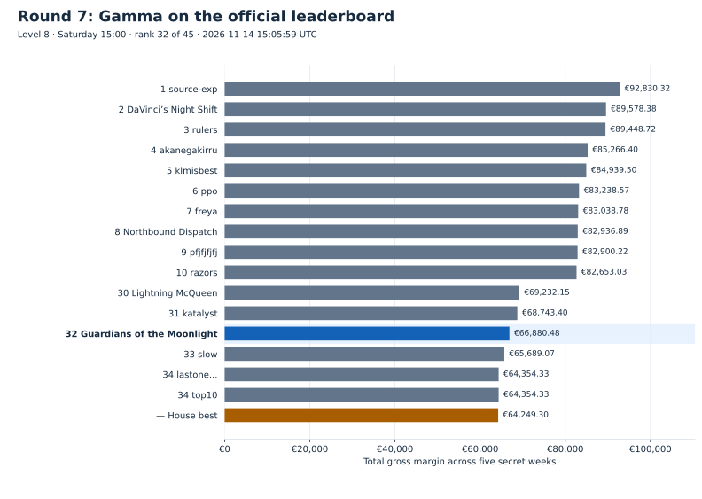
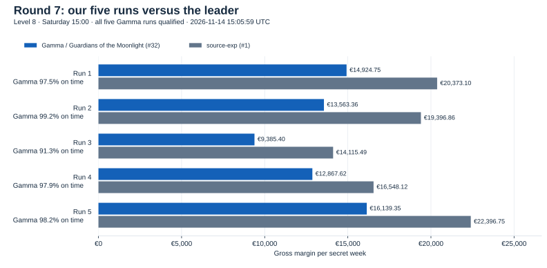

<p align="center">
  
</p>

# Cheap-Drive

A Python dispatcher for the Spread challenge, using the official client.
[How it works](https://spread.bahnexpress.com/how) · [Judging](https://spread.bahnexpress.com/judging) · [Leaderboard](https://spread.bahnexpress.com/leaderboard)

[Presentation: from Alpha to Gamma](presentations/README.md): eight slides with source notes and compact evidence.

> **Final is close — as of 14 November 2026, 15:20 Helsinki (UTC+2).**
> Sunday **15 November 2026, 08:00 Helsinki (06:00 UTC)**, lasts about 34 minutes.
> Registration closes **07:30 Helsinki (05:30 UTC)** that Sunday; start the dispatcher before **08:00**.
> Final submission: Sunday **15 November 2026, 10:00 Helsinki (08:00 UTC)**.
> Test finals: Saturday **14 November 2026, 14:00 and 20:00 Helsinki (12:00 and 18:00 UTC)**.
> **Missing: Alpha/Beta/Gamma dispatch has not been validated on final clocks; there is no final-mode runner yet.**
> [Schedule details](AI%20overview.md#event-deadlines-and-submission).

## Standings

Our public team is **Guardians of the Moonlight**. **Gamma completed all five
level-8 runs in round 7 ("Saturday 15:00", 14 November 2026, Helsinki time).**
At 2026-11-14 15:05:59 UTC, we are **#32 of 45 ranked teams**, with
**€66,880.48 total gross margin** and **96.75% on time**
on the official board. All five weeks qualified; the worst week was
91.35% on time (90% required in every week).
The round stays open until 18:00 Helsinki (16:00 UTC), so positions can change.

| Gamma run | Gross margin | On time | Orders won | Ranked |
| --- | ---: | ---: | ---: | :---: |
| 1 | €14,924.75 | 97.52% | 282 | Yes |
| 2 | €13,563.36 | 99.22% | 255 | Yes |
| 3 | €9,385.40 | 91.35% | 289 | Yes |
| 4 | €12,867.62 | 97.87% | 282 | Yes |
| 5 | €16,139.35 | 98.18% | 275 | Yes |
| **Total** | **€66,880.48** | **96.75%** | **1383** | **5 / 5** |

Leader **source-exp**: €92,830.32; tenth place:
€82,653.03 (we are €15,772.55 behind).
Organisers' **House best**: €64,249.30.
House teams have no public rank and are excluded from the ranked-team count.




*Charts generated from the official public leaderboard, retrieved 2026-11-14 15:05:59 UTC.
Exact cents are retained; the public page rounds margins to whole euros.*


*Real public-page screenshots captured after all five Gamma runs on
14 November 2026, 15:07 UTC (17:07 Helsinki). The first shows the round and leaders; the second shows our
ranked row and nearby teams. [Run and snapshot details](docs/research/gamma-board-round7.md).*

Previous round: unchanged **Beta** finished round 6 ("Saturday 12:00")
**45th of 58 ranked teams**, €59,528.62, with all five weeks qualified.
The rounds use different secret weeks, so their totals are not a paired model comparison.

## Schedule & Run Limits (Official Rules)

All event times are **Helsinki time (EET, UTC+2)**:

| Run Type | Schedule (Starts / Opens) | How Many You Can Submit |
| --- | --- | --- |
| **Ranking Rounds** (`--board` / `board: true`) | **Opens** at:<br>• **Fri:** `19:30`<br>• **Sat:** `00:00`, `09:00`, `12:00`, **`15:00`**, `18:00`, `21:00`<br>• **Sun:** `00:00`, `03:00`, `06:00`<br>*(e.g. the 15:00 round **starts** at 15:00 and stays open until 18:00)* | **5 runs per level, per round** (played one at a time in order 1–5; each secret week once).<br>• After 5 runs at a level, `board: true` returns `409` until the next round opens.<br>• Deleting an unfinished ranking run **still counts** (the server runs it to completion without your system).<br>• Runs started before the next round opens still count in the round they were created in. |
| **Practice Runs** (`--seed` / regular) | Anytime | **Unlimited** total runs.<br>• **Max 8 active (unended) worlds** at once per team (including `fork` copies and active ranking runs). Ended/deleted practice worlds free their slot. |
| **Test Finals** (`--final`) | **Starts** on **Sat** at **`14:00`** and **`20:00`** (~19 min each; set 15 min before at `13:45` and `19:45`) | **1 live world per team** per test final (2 test finals total). Restarting reconnects to the same world. |
| **The Final** (`--final`) | **Starts** on **Sun** at **`08:00`** (~34 min, ends ~`08:35`; set at `07:30`) | **1 live world per team** (Level 8). Top 10 ranked teams (≥90% on-time) advance to the jury. |
| **Junction Submission** | **Prelim:** Fri `23:59`<br>**Final:** Sun `10:00` | **1 team submission** on the Junction platform (submission hash, code link, 5–10 slides or short video). |

## Current model: Gamma

Gamma passed a frozen eight-seed confirmation against Beta: **8/8 ranked and
8/8 more profitable**, gaining **€2,031/week (+20.21%)**, with **96.95% worst
on-time delivery**. See the [recovery results](docs/research/gamma-recovery-results.md)
for the selection process, exact comparisons and remaining limits.

[models/gamma.json](models/gamma.json) uses `gamma_notes:make_gamma_notes_pairs`:
correct note dates/readiness and recurring business hours, guarded 500–700 km
routes, short-route/premium-car fee controls, and two-car pairs. Fresh pairs
open at 0.72 × summed reference fees; waiting-car rescue pairs open at 0.78 ×
with a new 60-minute flat period. Pair idle wait at the second pickup is capped
at 60 minutes. The brake, roster scaling and town caps remain disabled.

Beta remains available in [models/beta.json](models/beta.json). The original
notes-unaware guarded-700 candidate failed an earlier held-out week; it has
been replaced in `models/gamma.json`, and its [historical results](docs/research/gamma-results.md)
remain documented. Practice qualification does not validate final-clock integration.

## Results

Fresh confirmation on `gamma-v09` … `gamma-v16`, selected before any candidate
outcome on those seeds. On-time means are means of weekly shares.

| Model | Margin / week | Weeks ranked | On time: worst / mean | Orders / week |
| --- | ---: | ---: | ---: | ---: |
| Beta | €10,047.87 | 8 of 8 | 93.67% / 95.69% | 241.6 |
| Gamma | €12,078.71 | 8 of 8 | 96.95% / 98.06% | 256.3 |

Every paired week improved margin, by €886.79–€2,630.60. Only 1 of 148 won,
noncancelled long-route orders was late (0.68%, including undelivered orders).
Gamma also ranked on all eight screening weeks and three known difficult weeks;
those are exposed diagnostics, separate from confirmation.

Earlier results: [Gamma guarded-route research](docs/research/gamma-results.md),
[Beta](docs/research/beta-results.md), [Alpha](docs/research/alpha-results.md).
Further model work is parked in the [Delta handoff](docs/research/delta-handoff.md).

For context, round 6’s leading teams averaged about €18–22k and 430–470
orders/week on different ranking worlds; practice results are not directly comparable.

## What drove the changes

- List price ≈ driver cost away from the shortest routes; price each option from its own list.
- The markup must find each week's market; a fixed markup won very different volumes across weeks.
- Drivers learned to wait for fee raises. Open lower and spread the rise over the order's own time.
- Long routes caused half the late orders; the 500 km limit made all eight weeks rank.

## Setup

Python 3.9+; GitHub practice uses 3.12, CI checks 3.9, 3.12 and 3.14.

```bash
bash scripts/setup.sh
source .venv/bin/activate
python -m unittest discover -s tests
python dispatch.py --demo
```

Copy `.env.example` to git-ignored `.env`; set `SPREAD_KEY`
(your team key) and optionally `SPREAD_URL` (default `https://spread.bahnexpress.com`),
load it with `set -a; source .env; set +a`. The app does not load `.env` itself.
**Keep the key out of git.** For Actions, add those names as repository secrets in
**Settings → Secrets and variables → Actions**; secrets apply only to Actions.
[Setup and GitHub workflow details](docs/reference.md#setup).

## Run

Run from the repository root with the environment activated; live runs need
`SPREAD_KEY`. The team shares **8 unfinished practice-world slots**; completed weeks free slots. Keep traces and reports private under git-ignored `runs/`.

```bash
# Offline scripted demo; synthetic score, no key.
python dispatch.py --demo

# One fixed-price practice week.
python dispatch.py --level 4 --seed cheap-drive-1

# Paired Beta / Gamma weeks on shared seeds.
python compare.py run --model-a models/beta.json --model-b models/gamma.json \
  --levels 8 --seeds screen-1 screen-2 --workers 8 --fast --output runs/beta-vs-gamma

# Rebuild Markdown offline.
python compare.py report runs/beta-vs-gamma/results.json

# Sweep settings with plan.json below.
python scripts/sweep.py runs/gamma/check plan.json

# Public ranking runs; qualify on private seeds first.
python scripts/board.py models/gamma.json --runs 5 --fast

# Offline HTML report.
python week_report.py runs/my-run.jsonl --output runs/my-week.html
```

`compare.py run`: `--workers` defaults to 1 (1–8), capped at
observed free slots. `--fast` keeps events/actions but skips bookkeeping stops,
daily scores and end roster/reveal. Repeat the same command with `--resume`
to reuse completed weeks; code, configuration and output directory must match.
Interrupted worlds are not resumed. [Fast-practice limits](docs/research/official-run-performance.md).

Minimal `plan.json` (fast by default; reruns skip completed weeks):

```json
{"factory":"gamma:make_gamma","level":8,"seeds":["gamma-t01"],
 "base":{"win_target_bps":3000,"opening_fee_bps":8000,"max_km":500},
 "variants":{"beta":{},"long700g":{"long_max_km":700}}}
```

The server allows only one unfinished ranking run per level. Use `--runs 5`
to finish them sequentially; parallel invocations receive HTTP 409.

**Ranking runs are public and cannot be retried or taken back. All five runs
of a round must reach 90% on time.** Stopping or deleting one still counts.
Failed `dispatch.py` / `compare.py` worlds are preserved and may hold slots;
`--delete-on-error` deletes this invocation's failed worlds.
[Capture, reports, comparisons and workflow reference](docs/reference.md).

## Prototype conventions

Use Greek-letter names in order: Alpha, Beta, Gamma, and so on; see [PROTOTYPES.md](PROTOTYPES.md).
The private story lives in git-ignored `prototype-story/` and must never be committed.

## Checks

```bash
python -m unittest discover -s tests
```

Optional browser checks cover report controls, exports, security and mobile layout;
[commands and coverage](docs/reference.md#checks). They start no server or simulator world.

## Project icon

[The red-car SVG](assets/cheap-drive.svg) is the reusable project icon, with an accessible title and description.
