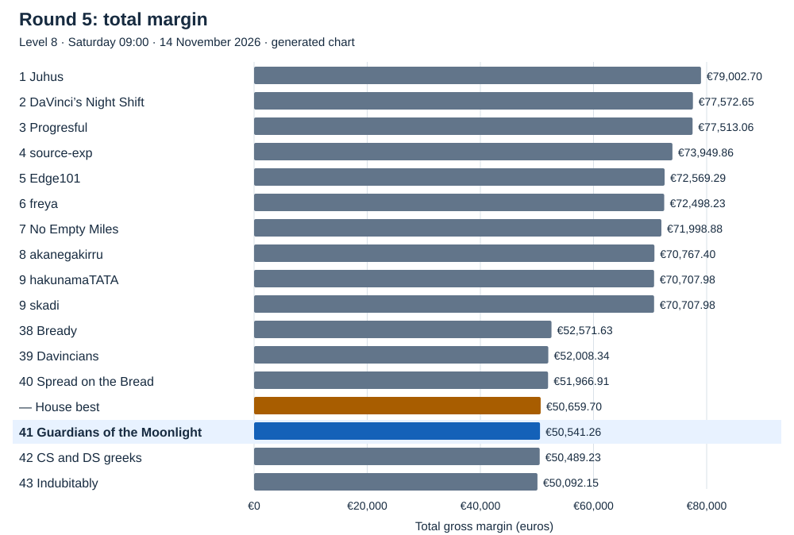
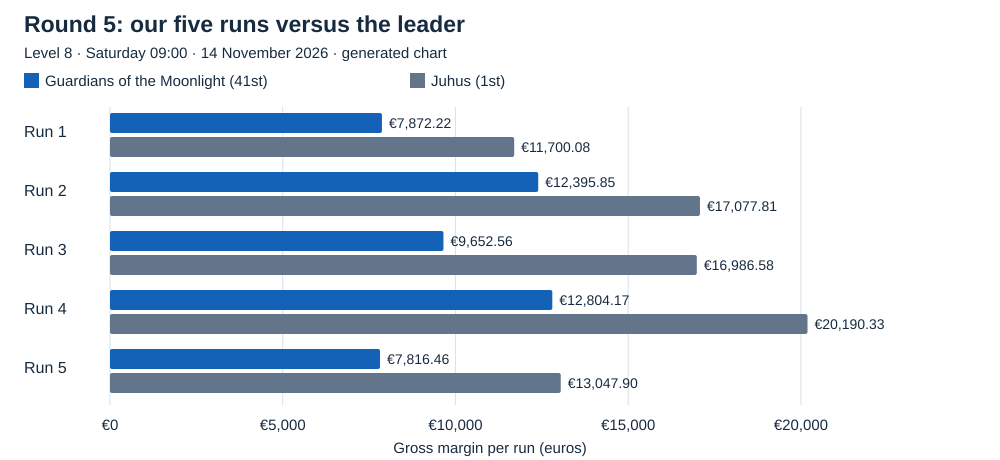
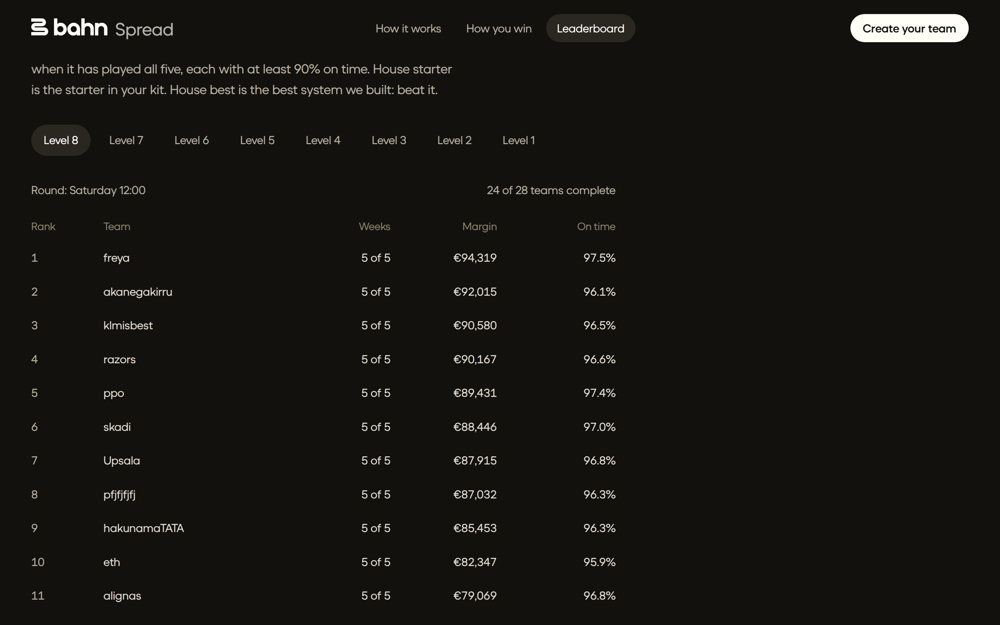

<p align="center">
  
</p>

# Cheap-Drive

A Python dispatcher for the Spread challenge, using the official client.
[How it works](https://spread.bahnexpress.com/how) · [Judging](https://spread.bahnexpress.com/judging) · [Leaderboard](https://spread.bahnexpress.com/leaderboard)

> **Final is close — as of 14 November 2026, 12:00 Helsinki (UTC+2).**
> Sunday **15 November 2026, 08:00 Helsinki (06:00 UTC)**, about 20 hours away; lasts about 34 minutes.
> Registration closes **07:30 Helsinki (05:30 UTC)** that Sunday; start the dispatcher before **08:00**.
> Final submission: Sunday **15 November 2026, 10:00 Helsinki (08:00 UTC)**.
> Test finals: Saturday **14 November 2026, 14:00 and 20:00 Helsinki (12:00 and 18:00 UTC)**.
> **Missing: Beta has only been played on practice clocks; there is no final-mode runner yet.**
> [Schedule details](AI%20overview.md#event-deadlines-and-submission).

## Standings

Our public team is **Guardians of the Moonlight**. Round 5 ("Saturday 09:00"), level 8:
**41st of 65 ranked teams**, €50,541; all five ranked, 95.5–98.7% on time.
Runs: €7,872 / €12,396 / €9,653 / €12,804 / €7,816. House best (organisers):
€50,660; tenth place about €71k; leaders €77–79k.
Round 6 ("Saturday 12:00"): **€59,528.62 with unchanged Beta**, all five ranked,
96.1–99.2% on time. All five finished before 15:00 Helsinki.




*Charts: 14 November 2026, retrieved 10:13:44 UTC. Exact cents in charts; research notes' whole euros in prose.*



*Real public-page screenshot, 14 November 2026, 10:14 UTC: only round 6 is shown; our round-5 row is unavailable.*

## Current model: Gamma

Gamma passed a frozen eight-seed confirmation against Beta: **8/8 ranked and
8/8 more profitable**, gaining **€2,031/week (+20.21%)**, with **96.95% worst
on-time delivery**. See the [recovery results](docs/research/gamma-recovery-results.md)
for the selection process, exact comparisons and remaining limits.

[models/gamma.json](models/gamma.json) uses `gamma_notes:make_gamma_notes_pairs`:
correct note dates/readiness and recurring business hours, guarded 500–700 km
routes, short-route/premium-car fee controls, and two-car pairs. Fresh pairs
open at 0.72 × summed reference fees; waiting-car rescue pairs open at 0.78 ×
with a new 60-minute flat period. Pair idle wait at the second pickup is capped
at 60 minutes. The brake, roster scaling and town caps remain disabled.

Beta remains available in [models/beta.json](models/beta.json). The original
notes-unaware guarded-700 candidate failed an earlier held-out week; it has
been replaced in `models/gamma.json`, and its [historical results](docs/research/gamma-results.md)
remain documented. Practice qualification does not validate final-clock integration.

## Results

Fresh confirmation on `gamma-v09` … `gamma-v16`, selected before any candidate
outcome on those seeds. On-time means are means of weekly shares.

| Model | Margin / week | Weeks ranked | On time: worst / mean | Orders / week |
| --- | ---: | ---: | ---: | ---: |
| Beta | €10,047.87 | 8 of 8 | 93.67% / 95.69% | 241.6 |
| Gamma | €12,078.71 | 8 of 8 | 96.95% / 98.06% | 256.3 |

Every paired week improved margin, by €886.79–€2,630.60. Only 1 of 148 won,
noncancelled long-route orders was late (0.68%, including undelivered orders).
Gamma also ranked on all eight screening weeks and three known difficult weeks;
those are exposed diagnostics, separate from confirmation.

Earlier results: [Gamma guarded-route research](docs/research/gamma-results.md),
[Beta](docs/research/beta-results.md), [Alpha](docs/research/alpha-results.md).
Further model work is parked in the [Delta handoff](docs/research/delta-handoff.md).

## What drove the changes

- List price ≈ driver cost away from the shortest routes; price each option from its own list.
- The markup must find each week's market; a fixed markup won very different volumes across weeks.
- Drivers learned to wait for fee raises. Open lower and spread the rise over the order's own time.
- Long routes caused half the late orders; the 500 km limit made all eight weeks rank.

## Setup

Python 3.9+; GitHub practice uses 3.12, CI checks 3.9, 3.12 and 3.14.

```bash
bash scripts/setup.sh
source .venv/bin/activate
python -m unittest discover -s tests
python dispatch.py --demo
```

Copy `.env.example` to git-ignored `.env`; set `SPREAD_KEY`
(your team key) and optionally `SPREAD_URL` (default `https://spread.bahnexpress.com`),
load it with `set -a; source .env; set +a`. The app does not load `.env` itself.
**Keep the key out of git.** For Actions, add those names as repository secrets in
**Settings → Secrets and variables → Actions**; secrets apply only to Actions.
[Setup and GitHub workflow details](docs/reference.md#setup).

## Run

Run from the repository root with the environment activated; live runs need
`SPREAD_KEY`. The team shares **8 unfinished practice-world slots**; completed weeks free slots. Keep traces and reports private under git-ignored `runs/`.

```bash
# Offline scripted demo; synthetic score, no key.
python dispatch.py --demo

# One fixed-price practice week.
python dispatch.py --level 4 --seed cheap-drive-1

# Paired Beta / Gamma weeks on shared seeds.
python compare.py run --model-a models/beta.json --model-b models/gamma.json \
  --levels 8 --seeds screen-1 screen-2 --workers 8 --fast --output runs/beta-vs-gamma

# Rebuild Markdown offline.
python compare.py report runs/beta-vs-gamma/results.json

# Sweep settings with plan.json below.
python scripts/sweep.py runs/gamma/check plan.json

# Public ranking runs; qualify on private seeds first.
python scripts/board.py models/gamma.json --runs 5 --fast

# Offline HTML report.
python week_report.py runs/my-run.jsonl --output runs/my-week.html
```

`compare.py run`: `--workers` defaults to 1 (1–8), capped at
observed free slots. `--fast` keeps events/actions but skips bookkeeping stops,
daily scores and end roster/reveal. Repeat the same command with `--resume`
to reuse completed weeks; code, configuration and output directory must match.
Interrupted worlds are not resumed. [Fast-practice limits](docs/research/official-run-performance.md).

Minimal `plan.json` (fast by default; reruns skip completed weeks):

```json
{"factory":"gamma:make_gamma","level":8,"seeds":["gamma-t01"],
 "base":{"win_target_bps":3000,"opening_fee_bps":8000,"max_km":500},
 "variants":{"beta":{},"long700g":{"long_max_km":700}}}
```

The server allows only one unfinished ranking run per level. Use `--runs 5`
to finish them sequentially; parallel invocations receive HTTP 409.

**Ranking runs are public and cannot be retried or taken back. All five runs
of a round must reach 90% on time.** Stopping or deleting one still counts.
Failed `dispatch.py` / `compare.py` worlds are preserved and may hold slots;
`--delete-on-error` deletes this invocation's failed worlds.
[Capture, reports, comparisons and workflow reference](docs/reference.md).

## Prototype conventions

Use Greek-letter names in order: Alpha, Beta, Gamma, and so on; see [PROTOTYPES.md](PROTOTYPES.md).
The private story lives in git-ignored `prototype-story/` and must never be committed.

## Checks

```bash
python -m unittest discover -s tests
```

Optional browser checks cover report controls, exports, security and mobile layout;
[commands and coverage](docs/reference.md#checks). They start no server or simulator world.

## Project icon

[The red-car SVG](assets/cheap-drive.svg) is the reusable project icon, with an accessible title and description.
