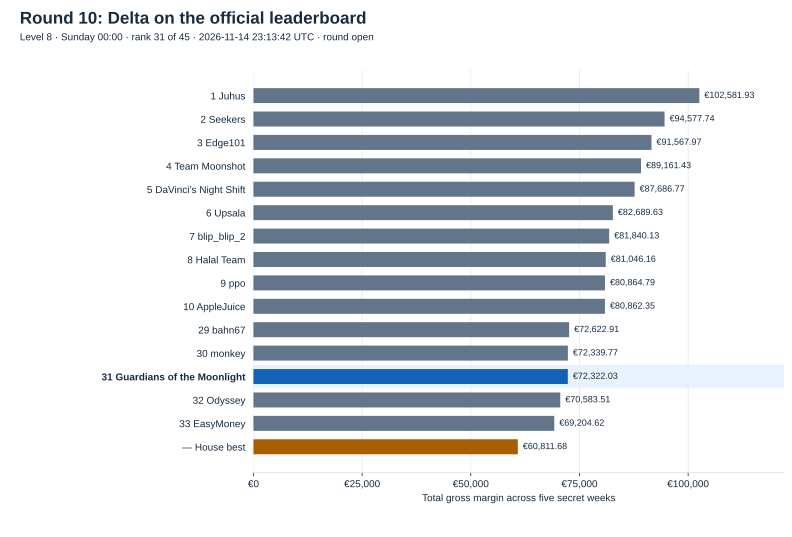
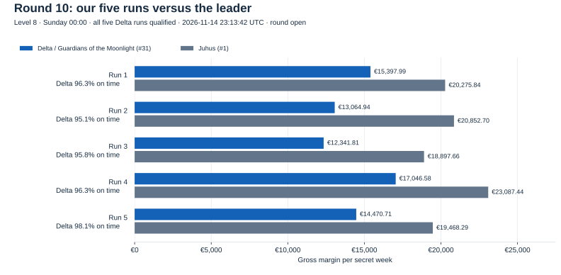
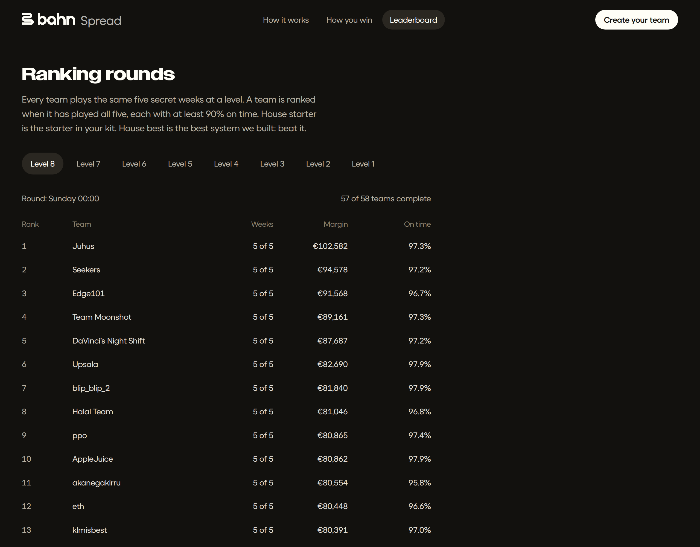
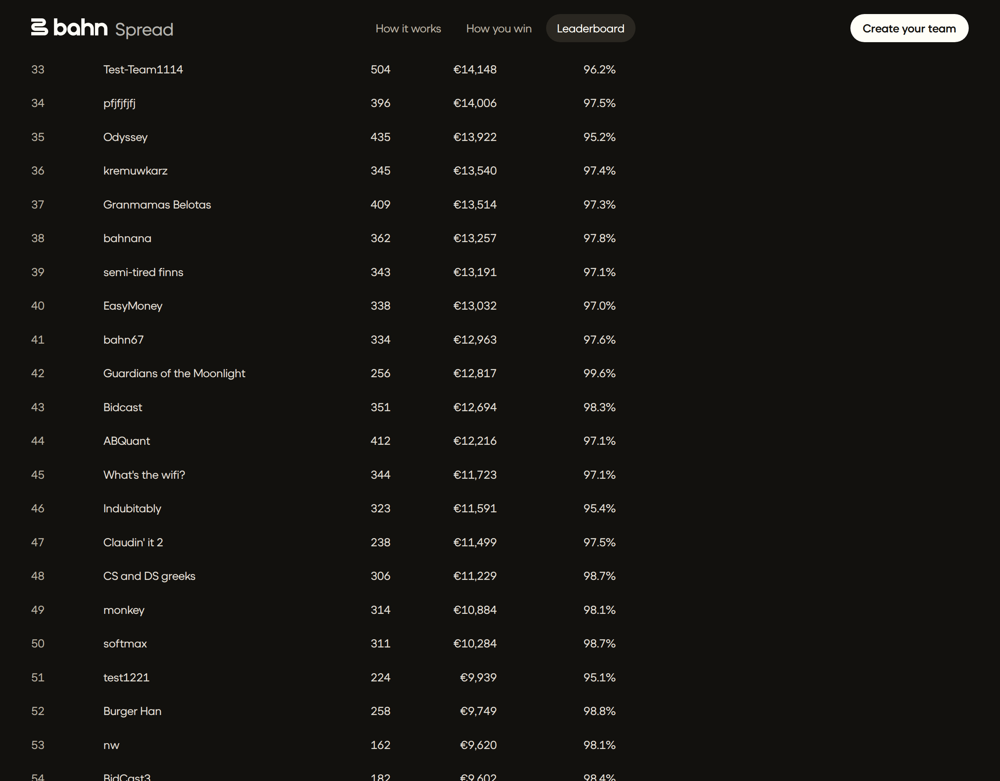

<p align="center">
  
</p>

# Cheap-Drive

A Python dispatcher for the Spread challenge, using the official client.
[How it works](https://spread.bahnexpress.com/how) · [Judging](https://spread.bahnexpress.com/judging) · [Leaderboard](https://spread.bahnexpress.com/leaderboard) · [Live analytics demo](https://kotviccodes.github.io/Cheap-Drive/)

Model code lives in the [models package](models/), alongside its JSON configs
(for example [models/delta.py](models/delta.py)). Runners and tools stay at the
root and in `scripts/`. Old imports and saved factory names still work through
one-line module aliases; see [model compatibility](docs/reference.md#model-package-compatibility).

**Delta** ([models/delta.json](models/delta.json)) takes on more work and offers it to
drivers better: a 42% win target instead of 30%, stops posted for the whole span an order
allows, pairs searched over 90 km, and rescue for overdue private deliveries. Over 19
paired practice weeks it earned **€1,664/week more than Early Delta** (17 of 19 weeks
ahead; 8 of the weeks unseen: +€1,389, 7 of 8), winning 342 orders a week instead of 257,
every week ranked. On time is lower: 95.7% on average against 96.9%, worst week 91.1%
against 93.7%.

**Early Delta** ([models/delta-early.json](models/delta-early.json)) is Gamma plus two
repairs: bounded note corrections and a rescue-window fix. It beat Gamma on 11 of 11 unseen
weeks by €682/week (+€518/week over 27 paired weeks). The pricing experiments in between
(segments, lanes, small intake changes, learner, price spread) did not hold on fresh weeks.
[Delta results](docs/research/delta-results.md) · [next steps](docs/research/delta-next-steps.md) ·
[testing plan](docs/research/delta-testing-plan.md).

[Delta next steps](docs/research/delta-next-steps.md): ranked service-protection tweaks for tonight and larger ideas parked for the next model.

> Test finals: Saturday **14 November 2026, 14:00 and 20:00 Helsinki**. The final: Sunday **15 November 2026, 08:00 Helsinki**, about 34 minutes; submission by **10:00**.
> **Final mode:** `python final.py models/delta.json` waits for the (test) final and plays it from the live stream; rerun the same command to rejoin after a crash. `--rehearse SEED` creates or resumes a paced practice rehearsal. Keep `runs/final/` for checkpoints and quote receipts. See the [recovery handoff](docs/research/final-rejoin-recovery.md) for the outage findings, offline validation and kill/restart drill.
> [Schedule and run limits](docs/reference.md#event-schedule-and-run-limits) · [Challenge constraints](docs/challenge.md).

## Standings

Our public team is **Guardians of the Moonlight**. **Delta completed all five
level-8 runs in round 10 ("Sunday 00:00", 15 November 2026, Helsinki time).**
At 2026-11-14 23:13:42 UTC, we are **#31 of 45 ranked teams**,
with **€72,322.03 total gross margin** and **96.27% on time**.
All five weeks qualified; the worst week was 95.11% on time
(90% required in every week). The round remains open until 01:00 UTC
on 15 November, so positions can change.
The runs used [models/delta.json](models/delta.json) at code revision
[cae1e58](https://github.com/KotvicCodes/Cheap-Drive/commit/cae1e58b8ce3234260328f78dcf2283cd2ebced7).

| Delta run | Gross margin | On time | Orders won | Ranked |
| --- | ---: | ---: | ---: | :---: |
| 1 | €15,397.99 | 96.32% | 353 | Yes |
| 2 | €13,064.94 | 95.11% | 368 | Yes |
| 3 | €12,341.81 | 95.79% | 356 | Yes |
| 4 | €17,046.58 | 96.34% | 355 | Yes |
| 5 | €14,470.71 | 98.06% | 310 | Yes |
| **Total** | **€72,322.03** | **96.27%** | **1742** | **5 / 5** |

Leader **Juhus**: €102,581.93; tenth place:
**AppleJuice**, €80,862.35 (we are €8,540.32 behind).
Organisers' **House best**: €60,811.68.
House teams have no public rank and are excluded from the ranked-team count.




*Charts generated from the official public leaderboard, retrieved 2026-11-14 23:13:42 UTC.
Exact cents are retained; the public page rounds margins to whole euros.*




*Real public-page screenshots captured at 2026-11-14 23:14:25 UTC (leaders) and
2026-11-14 23:14:11 UTC (our row), after all five Delta runs, while the round was open.
[Run and snapshot details](docs/research/delta-board-round10.md).*

Previous round: **Delta**, round 9 ("Saturday 21:00"), finished
**34th of 56 ranked teams**, €75,763.55,
96.72% on time, all five qualified (closed-round data retrieved 2026-11-14 23:13:42 UTC).
[Earlier round-9 snapshot and evidence](docs/research/delta-board-round9.md).

Previous rounds: **Early Delta**, round 8 ("Saturday 18:00"),
**37th of 58 ranked teams**, €55,639.62, 96.96% on time, all five weeks qualified
(open-round snapshot retrieved 2026-11-14 17:53:55 UTC).
[Round-8 snapshot and evidence](docs/research/delta-board-round8.md).
**Gamma** finished round 7 ("Saturday 15:00")
**41st of 62 ranked teams**, €66,880.48, 96.75% on time,
with all five weeks qualified (closed-round data retrieved 2026-11-14 17:53:55 UTC).
[Earlier round-7 snapshot and evidence](docs/research/gamma-board-round7.md).
These rounds used different secret weeks, so their totals are not a paired
comparison of the models; the paired practice evidence is in
[Delta results](docs/research/delta-results.md).

### Test final

In the test final on **14 November 2026, 20:00 Helsinki (18:00 UTC)**,
**Delta via `final.py`** finished **#42 of 75 ranked teams**, with
**€12,816.67 gross margin**, **99.61% on time** and **256 orders won**.
The public final feed, retrieved **2026-11-14 18:40:38 UTC**, reports leader
**Juhus at €19,592.05** and tenth-place **Team Moonshot at €16,622.58**.

The run was interrupted: during a server restart the connection dropped twice
around Friday of the simulated week (world minute 6871) and the runner rebuilt
its desk on Saturday (minute 7849). Requests that arrived in that gap went
unanswered; how many is not measured. After the rebuild the world sent no
further price requests, so the flat order count from Saturday is not a quoting
failure.




*Real public-page screenshots captured on 14 November 2026 at 18:41:23 UTC
(leaders) and 18:41:39 UTC (our row); the page rounds euros and percentages.
[Exact figures and interruption details](docs/research/delta-test-final-2.md).*

## Schedule & Run Limits (Official Rules)

All event times are **Helsinki time (EET, UTC+2)**:

| Run Type | Schedule (Starts / Opens) | How Many You Can Submit |
| --- | --- | --- |
| **Ranking Rounds** (`--board` / `board: true`) | **Opens** at:<br>• **Fri:** `19:30`<br>• **Sat:** `00:00`, `09:00`, `12:00`, **`15:00`**, `18:00`, `21:00`<br>• **Sun:** `00:00`, `03:00`, `06:00`<br>*(e.g. the 15:00 round **starts** at 15:00 and stays open until 18:00)* | **5 runs per level, per round** (played one at a time in order 1–5; each secret week once).<br>• After 5 runs at a level, `board: true` returns `409` until the next round opens.<br>• Deleting an unfinished ranking run **still counts** (the server runs it to completion without your system).<br>• Runs started before the next round opens still count in the round they were created in. |
| **Practice Runs** (`--seed` / regular) | Anytime | **Unlimited** total runs.<br>• **Max 8 active (unended) worlds** at once per team (including `fork` copies and active ranking runs). Ended/deleted practice worlds free their slot. |
| **Test Finals** (`--final`) | **Starts** on **Sat** at **`14:00`** and **`20:00`** (~19 min each; set 15 min before at `13:45` and `19:45`) | **1 live world per team** per test final (2 test finals total). Restarting reconnects to the same world. |
| **The Final** (`--final`) | **Starts** on **Sun** at **`08:00`** (~34 min, ends ~`08:35`; set at `07:30`) | **1 live world per team** (Level 8). Top 10 ranked teams (≥90% on-time) advance to the jury. |
| **Junction Submission** | **Prelim:** Fri `23:59`<br>**Final:** Sun `10:00` | **1 team submission** on the Junction platform (submission hash, code link, 5–10 slides or short video). |

## Current qualified baseline: Gamma

Gamma passed a frozen eight-seed confirmation against Beta: **8/8 ranked and
8/8 more profitable**, gaining **€2,031/week (+20.21%)**, with **96.95% worst
on-time delivery**. See the [recovery results](docs/research/gamma-recovery-results.md)
for the selection process, exact comparisons and remaining limits.

[models/gamma.json](models/gamma.json) uses `models.gamma_notes:make_gamma_notes_pairs`:
correct note dates/readiness and recurring business hours, guarded 500–700 km
routes, short-route/premium-car fee controls, and two-car pairs. Fresh pairs
open at 0.72 × summed reference fees; waiting-car rescue pairs open at 0.78 ×
with a new 60-minute flat period. Pair idle wait at the second pickup is capped
at 60 minutes. The brake, roster scaling and town caps remain disabled.

Beta remains available in [models/beta.json](models/beta.json). The original
notes-unaware guarded-700 candidate failed an earlier held-out week; it has
been replaced in `models/gamma.json`, and its [historical results](docs/research/gamma-results.md)
remain documented. Practice qualification does not validate final-clock integration.

## Results

Fresh confirmation on `gamma-v09` … `gamma-v16`, selected before any candidate
outcome on those seeds. On-time means are means of weekly shares.

| Model | Margin / week | Weeks ranked | On time: worst / mean | Orders / week |
| --- | ---: | ---: | ---: | ---: |
| Beta | €10,047.87 | 8 of 8 | 93.67% / 95.69% | 241.6 |
| Gamma | €12,078.71 | 8 of 8 | 96.95% / 98.06% | 256.3 |

Every paired week improved margin, by €886.79–€2,630.60. Only 1 of 148 won,
noncancelled long-route orders was late (0.68%, including undelivered orders).
Gamma also ranked on all eight screening weeks and three known difficult weeks;
those are exposed diagnostics, separate from confirmation.

Earlier results: [Gamma guarded-route research](docs/research/gamma-results.md),
[Beta](docs/research/beta-results.md), [Alpha](docs/research/alpha-results.md).
The next proposed experiments and known note cases are in the
[Delta handoff](docs/research/delta-handoff.md).

For context, round 6’s leading teams averaged about €18–22k and 430–470
orders/week on different ranking worlds; practice results are not directly comparable.

Public ranking evidence is from Beta: [rounds 5 and 6](docs/research/beta-results.md#ranking-round-5-level-8),
with [round-6 charts](docs/screenshots/README.md#leaderboard-visuals). Those dated
results describe completed rounds, not current standings.

## What drove the changes

- List price ≈ driver cost away from the shortest routes; price each option from its own list.
- The markup must find each week's market; a fixed markup won very different volumes across weeks.
- Drivers learned to wait for fee raises. Open lower and spread the rise over the order's own time.
- Long routes caused half the late orders; the 500 km limit made all eight weeks rank.

## Setup

Python 3.9+; GitHub practice uses 3.12, CI checks 3.9, 3.12 and 3.14.

```bash
bash scripts/setup.sh
source .venv/bin/activate
python -m unittest discover -s tests
python dispatch.py --demo
```

Copy `.env.example` to git-ignored `.env`; set `SPREAD_KEY`
(your team key) and optionally `SPREAD_URL` (default `https://spread.bahnexpress.com`),
load it with `set -a; source .env; set +a`. The app does not load `.env` itself.
**Keep the key out of git.** For Actions, add those names as repository secrets in
**Settings → Secrets and variables → Actions**; secrets apply only to Actions.
[Setup and GitHub workflow details](docs/reference.md#setup).

## Run

Run from the repository root with the environment activated; live runs need
`SPREAD_KEY`. The team shares **8 unfinished practice-world slots**; completed weeks free slots. Keep traces and reports private under git-ignored `runs/`.

```bash
# Offline scripted demo; synthetic score, no key.
python dispatch.py --demo

# One fixed-price practice week.
python dispatch.py --level 4 --seed cheap-drive-1

# Paired Beta / Gamma weeks on shared seeds.
python compare.py run --model-a models/beta.json --model-b models/gamma.json \
  --levels 8 --seeds screen-1 screen-2 --workers 8 --fast --output runs/beta-vs-gamma

# Rebuild Markdown offline.
python compare.py report runs/beta-vs-gamma/results.json

# Sweep settings with plan.json below.
python scripts/sweep.py runs/gamma/check plan.json

# Public ranking runs; qualify on private seeds first.
python scripts/board.py models/gamma.json --runs 5 --fast

# Offline HTML report.
python week_report.py runs/my-run.jsonl --output runs/my-week.html

# Multi-run interactive analytics demo bundle.
python scripts/build_demo.py
```

`compare.py run`: `--workers` defaults to 1 (1–8), capped at
observed free slots. `--fast` keeps events/actions but skips bookkeeping stops,
daily scores and end roster/reveal. Repeat the same command with `--resume`
to reuse completed weeks; code, configuration and output directory must match.
Interrupted worlds are not resumed. [Fast-practice limits](docs/research/official-run-performance.md).

Minimal `plan.json` (fast by default; reruns skip completed weeks):

```json
{"factory":"gamma:make_gamma","level":8,"seeds":["gamma-t01"],
 "base":{"win_target_bps":3000,"opening_fee_bps":8000,"max_km":500},
 "variants":{"beta":{},"long700g":{"long_max_km":700}}}
```

The server allows only one unfinished ranking run per level. Use `--runs 5`
to finish them sequentially; parallel invocations receive HTTP 409.

**Ranking runs are public and cannot be retried or taken back. All five runs
of a round must reach 90% on time.** Stopping or deleting one still counts.
Failed `dispatch.py` / `compare.py` worlds are preserved and may hold slots;
`--delete-on-error` deletes this invocation's failed worlds.
[Capture, reports, comparisons and workflow reference](docs/reference.md).

## Prototype conventions

Use Greek-letter names in order: Alpha, Beta, Gamma, and so on; see [PROTOTYPES.md](PROTOTYPES.md).
The private story lives in git-ignored `prototype-story/` and must never be committed.

## Checks

```bash
python -m unittest discover -s tests
```

Optional browser checks cover report controls, exports, security and mobile layout;
[commands and coverage](docs/reference.md#checks). They start no server or simulator world.

## Project icon

[The red-car SVG](assets/cheap-drive.svg) is the reusable project icon, with an accessible title and description.
