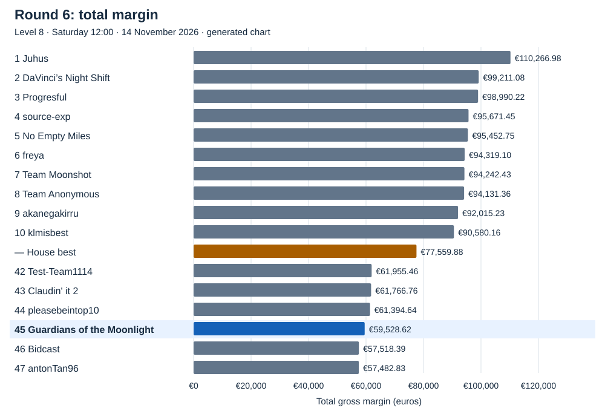
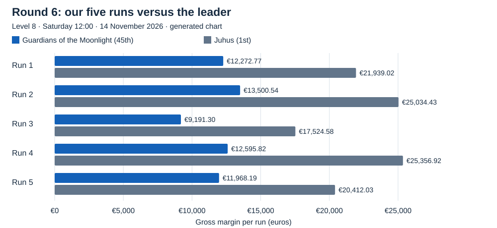
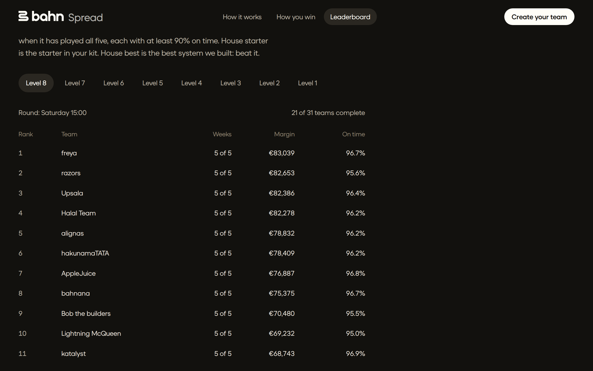

<p align="center">
  
</p>

# Cheap-Drive

A Python dispatcher for the Spread challenge, using the official client.
[How it works](https://spread.bahnexpress.com/how) · [Judging](https://spread.bahnexpress.com/judging) · [Leaderboard](https://spread.bahnexpress.com/leaderboard)

> **Final is close — as of 14 November 2026, 15:20 Helsinki (UTC+2).**
> Sunday **15 November 2026, 08:00 Helsinki (06:00 UTC)**, about 17 hours away; lasts about 34 minutes.
> Registration closes **07:30 Helsinki (05:30 UTC)** that Sunday; start the dispatcher before **08:00**.
> Final submission: Sunday **15 November 2026, 10:00 Helsinki (08:00 UTC)**.
> Test finals: Saturday **14 November 2026, 14:00 and 20:00 Helsinki (12:00 and 18:00 UTC)**.
> **Missing: Beta has only been played on practice clocks; there is no final-mode runner yet.**
> [Schedule details](AI%20overview.md#event-deadlines-and-submission).

## Standings

Our public team is **Guardians of the Moonlight**. Round 6 ("Saturday 12:00"), level 8:
**45th of 58 ranked teams**, €59,529; all five ranked, 96.1–99.2% on time.
Runs: €12,273 / €13,501 / €9,191 / €12,596 / €11,968. House best (organisers):
€77,560; tenth place about €91k; leaders €99–110k. (Round 5, "Saturday 09:00":
41st of 65, €50,541.) Round 7 ("Saturday 15:00"): current; we have not played it.




*Charts: 14 November 2026, retrieved 13:20:20 UTC. Exact cents in charts; research notes' whole euros in prose.*



*Real public-page screenshot, 14 November 2026, 13:18 UTC: only round 7 is shown; our round-6 row is unavailable.*

## Current model: Beta

Each option's quote is its list price × a markup that follows the market to a
30% win share, with 1% extra per on-time order delivered to that dealer (up to 25;
a late order halves the count). Driver fees open at 0.8 × the typical fee and
reach 1.5 × at the deadline warning; the starter's rescue fees apply afterwards.
Beta declines trade-ins, routes over 500 km and options leaving a driver under
8 hours from the dealer's decision to the last feasible pickup.

Parameters in [models/beta.json](models/beta.json): `win_target_bps=3000`,
`opening_fee_bps=8000`, `max_km=500`.
Fixed €100 quotes / €150 driver fees and the official starter are pre-Alpha baselines.

## Results

| Model / comparison | Margin / week | Weeks ranked | On time: worst / mean | Orders / week |
| --- | --- | --- | --- | --- |
| Alpha, its six seeds | about €6,200 | 6 of 6 | 91.2% / 95.0% | 297 |
| Beta, eight seeds | €10,786 | 8 of 8 | 93.9% / 96.2% | 246 |
| Leading teams, ranking round 6 | about €18–22k | 5 of 5 | 93–99% | 430–470 |

Alpha and Beta used **different seeds**, not a paired test.
Round 6's five runs totalled **€59,529**, all ranked: **45th of 58**, against about
€91k for tenth place (round 5: **€50,541**, **41st of 65**, tenth about €71k).
Reaching the final's top ten needs roughly **40–50% more margin**;
the gap is order volume (Beta about 250 orders/week versus the leaders' 350–470).
Settings were chosen on these eight seeds; generalisation is uncertain.
Details: [Beta results](docs/research/beta-results.md), [Alpha results](docs/research/alpha-results.md).

## What drove the changes

- List price ≈ driver cost away from the shortest routes; price each option from its own list.
- The markup must find each week's market; a fixed markup won very different volumes across weeks.
- Drivers learned to wait for fee raises. Open lower and spread the rise over the order's own time.
- Long routes caused half the late orders; the 500 km limit made all eight weeks rank.

## Setup

Python 3.9+; GitHub practice uses 3.12, CI checks 3.9, 3.12 and 3.14.

```bash
bash scripts/setup.sh
source .venv/bin/activate
python -m unittest discover -s tests
python dispatch.py --demo
```

Copy `.env.example` to git-ignored `.env`; set `SPREAD_KEY`
(your team key) and optionally `SPREAD_URL` (default `https://spread.bahnexpress.com`),
load it with `set -a; source .env; set +a`. The app does not load `.env` itself.
**Keep the key out of git.** For Actions, add those names as repository secrets in
**Settings → Secrets and variables → Actions**; secrets apply only to Actions.
[Setup and GitHub workflow details](docs/reference.md#setup).

## Run

Run from the repository root with the environment activated; live runs need
`SPREAD_KEY`. The team shares **8 unfinished practice-world slots**; completed weeks free slots. Keep traces and reports private under git-ignored `runs/`.

```bash
# Offline scripted demo; synthetic score, no key.
python dispatch.py --demo

# One fixed-price practice week.
python dispatch.py --level 4 --seed cheap-drive-1

# Paired Beta / Alpha weeks on shared seeds.
python compare.py run --model-a models/beta.json --model-b models/alpha.json \
  --levels 8 --seeds screen-1 screen-2 --workers 8 --fast --output runs/beta-vs-alpha

# Rebuild Markdown offline.
python compare.py report runs/beta-vs-alpha/results.json

# Sweep settings with plan.json below.
python scripts/sweep.py runs/beta/check plan.json

# Public ranking runs; qualify on private seeds first.
python scripts/board.py models/beta.json --runs 5

# Offline HTML report.
python week_report.py runs/my-run.jsonl --output runs/my-week.html
```

`compare.py run`: `--workers` defaults to 1 (1–8), capped at
observed free slots. `--fast` keeps events/actions but skips bookkeeping stops,
daily scores and end roster/reveal. Repeat the same command with `--resume`
to reuse completed weeks; code, configuration and output directory must match.
Interrupted worlds are not resumed. [Fast-practice limits](docs/research/official-run-performance.md).

Minimal `plan.json` (fast by default; reruns skip completed weeks):

```json
{"factory":"beta:make_beta","level":8,"seeds":["beta-01"],
 "variants":{"beta":{"win_target_bps":3000,"opening_fee_bps":8000,"max_km":500}}}
```

**Ranking runs are public and cannot be retried or taken back. All five runs
of a round must reach 90% on time.** Stopping or deleting one still counts.
Failed `dispatch.py` / `compare.py` worlds are preserved and may hold slots;
`--delete-on-error` deletes this invocation's failed worlds.
[Capture, reports, comparisons and workflow reference](docs/reference.md).

## Prototype conventions

Use Greek-letter names in order: Alpha, Beta, Gamma, and so on; see [PROTOTYPES.md](PROTOTYPES.md).
The private story lives in git-ignored `prototype-story/` and must never be committed.

## Checks

```bash
python -m unittest discover -s tests
```

Optional browser checks cover report controls, exports, security and mobile layout;
[commands and coverage](docs/reference.md#checks). They start no server or simulator world.

## Project icon

[The red-car SVG](assets/cheap-drive.svg) is the reusable project icon, with an accessible title and description.
