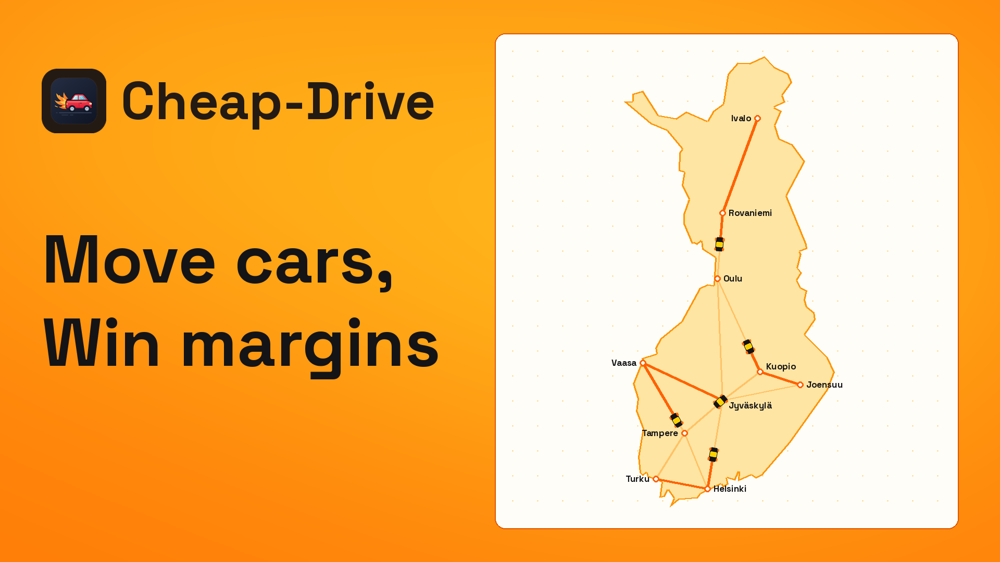
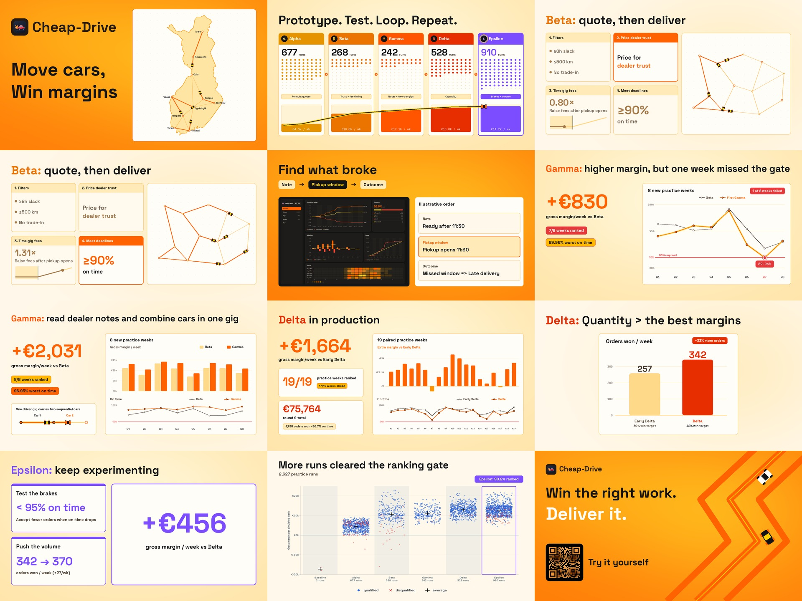

# Cheap-Drive event demo

A fast-paced 60-second motion film for the Bahn/Spread challenge at Junction 2026. Full HD, 30 fps, H.264/AAC MP4. The film combines a 2×2 policy bento replay, a real offline-report screenshot, the 6-stage 1,155-run experiment search, the 4-stage holdout vs. confirmation progression, the 8-week fresh Gamma confirmation (`v09–v16`), and both saved five-week official Beta ranking rounds.

The soundtrack is an original, deterministic 128 BPM instrumental synthesized by the renderer. There is no spoken narration. Main messages are on screen; an optional text track is supplied beside the video.

- **Watch live on GitHub Pages**: https://kotviccodes.github.io/Cheap-Drive/video/
- **Direct MP4 stream / download**: https://kotviccodes.github.io/Cheap-Drive/video/cheap-drive-demo.mp4





## Render

Python 3.12+ with the pinned dependencies in an isolated environment:

```sh
python3 -m venv runs/demo-video/.venv
runs/demo-video/.venv/bin/pip install -r docs/demo-video/requirements.txt
runs/demo-video/.venv/bin/python docs/demo-video/render.py --stills
runs/demo-video/.venv/bin/python docs/demo-video/render.py --draft
runs/demo-video/.venv/bin/python docs/demo-video/render.py
```

Output defaults to `runs/demo-video/` (ignored by Git); `--output /absolute/path` overrides it. The final file is `cheap-drive-demo.mp4`. Still mode writes full-resolution review frames, a contact sheet, and a poster. Draft mode writes a 540p, 15 fps MP4. Rendering makes no simulator requests and needs no credentials or network access. `imageio-ffmpeg` supplies the encoder.

## Film timeline (60s)

| Time | Scene |
| --- | --- |
| 00:00–00:05 | Cheap-Drive — Move cars, Win margins. Full Finland map with multi-city inland routes. |
| 00:05–00:13 | Prototype. Test. Loop. Repeat.: Graphical `α Alpha → β Beta → γ Gamma → δ Delta → ε Epsilon` iteration pipeline (`677`, `268`, `242`, `528`, `910` runs; `2,627 testing runs`, `5 models`, `2B tokens burned`) with run-volume matrices and rising margin trajectory (`€4.5k → €10.0k → €12.1k → €13.8k → €14.2k/wk`). |
| 00:13–00:20 | Beta: quote, then deliver — 2×2 Dispatch Bento (`Filter requests`, `Price dealer trust`, `Time gig fees 0.80× → 1.50×`, `Meet deadlines ≥90%`). |
| 00:20–00:26 | Find what broke: Smooth-scrolling live demo app preview + `Note → Pickup window → Outcome` order inspection. |
| 00:26–00:33 | Gamma: higher margin, but one week missed the gate (`+€830/wk`, `7/8 weeks ranked`, `W7` at `89.96%` on time). |
| 00:33–00:40 | Gamma: read dealer notes and combine cars in one gig (`+€2,031/week vs Beta` across 8 new practice weeks, `8/8 weeks qualified`, `96.95%` worst on time). |
| 00:40–00:47 | Delta in production (`+€1,664/week vs Early Delta` across 19 paired practice weeks, `19/19 practice weeks ranked`, `€75,764` Round 9 total across `5/5 ranked weeks`). |
| 00:47–00:53 | Delta: Quantity > the best margins (`Orders won / week`: `257` at `30%` win target → `342` at `42%` win target, `+33% more orders`). |
| 00:53–01:00 | Epsilon: keep experimenting (`Test the brakes` < 95% trailing 24h on-time, `Push the volume` `343 → 370 orders/wk`, `+€456/wk` across 38 paired practice weeks, `€69,301` Round 11 total across `5/5 ranked weeks`). |
| 01:00–01:07 | More runs cleared the ranking gate (`2,627 practice runs` across `Baseline: 2`, `Alpha: 677`, `Beta: 268`, `Gamma: 242`, `Delta: 528`, `Epsilon: 910`). |
| 01:07–01:12 | Highway close (`Win the right work. Deliver it.` + QR code `Try it yourself`). |

## Evidence and limits

The source is the presentation handoff prepared in the Presentation thread, updated at **2026-11-14 14:25:00 UTC** (`updates/run-refresh-20261114T142500Z/`).

- `data/graph-data.json`, `data/chart-data.json`, and `assets/all-run-margins.png` contain **1,155 completed practice worlds across 58 seed+level scenarios**, plus **10 official ranking worlds** (`1,165 scored worlds` total). Practice runs are grouped into 6 model stages (`Baseline`, `Alpha`, `Beta Early`, `Beta Late`, `Gamma Early`, `Gamma Late`). Repeated seeds are correlated; this is not 1,155 independent validation weeks.
- `data/cohort-comparisons.csv`, `data/paired-weeks.csv`, `assets/learning-stages.png`, and `assets/gamma-confirmation.png` record the 4-stage validation progression:
  1. **Original candidate: tuning (`gamma-t01…t08`)**: `+€1,231.75/week`, `8/8 qualified`, worst OT `92.98%`.
  2. **Original candidate: fresh holdout (`gamma-h01…h08`)**: `+€830.44/week`, **`7/8 qualified`** — failed on `gamma-h07` (`89.956%` on-time, just below the `90%` minimum).
  3. **Revised candidate (`notes + repaired pairs + segment controls`): screening (`gamma-v01…v08`)**: `+€1,585.95/week`, `8/8 qualified`, worst OT `94.57%`.
  4. **Revised candidate: fresh confirmation (`gamma-v09…v16`)**: Unchanged Beta `€10,047.87/week` vs. Revised Gamma `€12,078.71/week` (**`+€2,030.845/week`, `+20.21%`**), **`8/8 positive`**, **`8/8 qualified`**, worst on-time rising from **`93.671%` to `96.947%`**.
- `data/official-rounds.csv` and `assets/official-rounds.png` record the two saved five-week official Beta ranking rounds: **Round 5 (`€50,541.26`, `5/5 qualified`, `95.49%` worst OT)** and **Round 6 (`€59,528.62`, `5/5 qualified`, `96.11%` worst OT)**. Rounds use different secret worlds; the difference is not a paired policy comparison or a Gamma result.
- The report screenshot is the repository's `docs/screenshots/week-overview.png`: a **level-4 fixed-baseline tooling example**, not Beta/Gamma/official performance.

The renderer validates all world counts, stage counts, paired confirmation means and qualification flags, both official ranking round totals, and the stress-test metrics before rendering.

## Assets

Space Grotesk and IBM Plex Mono are included under their accompanying SIL Open Font License files. Visuals are code-drawn apart from the existing report screenshot and supplied charts. The music contains no external recordings or samples.
